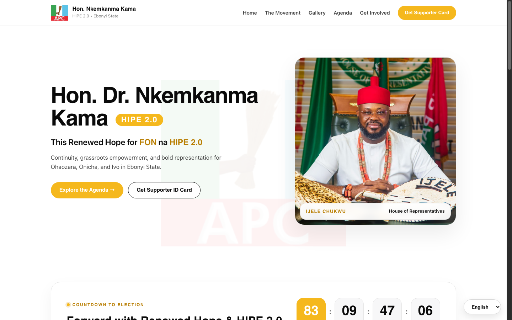
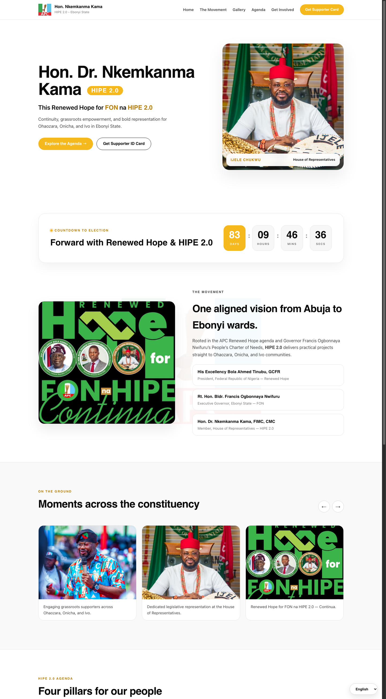
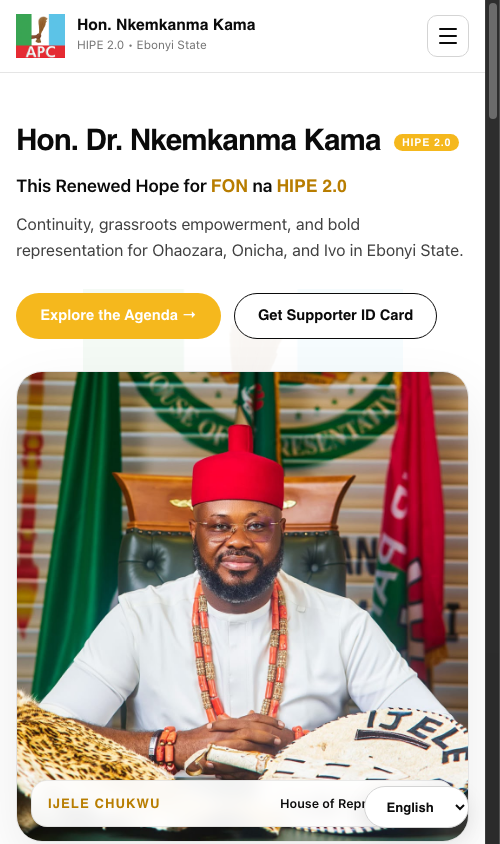

# Campaign-Site

Official React + Vite campaign web app for **Hon. Dr. Nkemkanma Kama (Ijele Chukwu)** — *This Renewed Hope for FON na HIPE 2.0*, Ohaozara / Onicha / Ivo Federal Constituency, Ebonyi State.

Built with **React 19** and **Vite** in a clean **white, black, and gold** design with the APC logo as the primary brand mark and subtle faded background watermark, ready for zero-config deployment on **Vercel**.

## Screenshots

### Desktop Hero & Navigation


### Full Page Overview


### Mobile Responsive View


## Features

- **Clean White, Black & Gold UI**: High-contrast editorial layout with a faded APC logo watermark across the canvas.
- **Live Election Countdown**: Real-time countdown timer targeting February 6, 2027.
- **The Movement & Gallery**: Leadership overview and scrollable constituency photo gallery.
- **HIPE 2.0 Four-Pillar Agenda**: Rural Roads & Water, Youth & Enterprise, Schools & Healthcare, and Strong Voice in Abuja.
- **Supporter ID Card Generator & Lookup**:
  - Ward-level registration across Ohaozara, Onicha, and Ivo (`public/data/wards.json`).
  - Optional client-side selfie capture or image upload preview (kept on-device).
  - Generates printable front & back HIPE 2.0 Supporter ID cards with `localStorage` persistence and Card ID / phone lookup.
- **Multi-language Support**: Built-in Google Translate selector (English, Igbo, Hausa, Yoruba, Pidgin, French).

## Getting Started

```bash
npm install
npm run dev
```

Build for production:

```bash
npm run build
```

## Deploying to Vercel

1. Push this repository to GitHub.
2. Import the repository in [Vercel](https://vercel.com) (framework preset: **Vite**, build command: `npm run build`, output directory: `dist`).
3. Deploy — no server-side runtime or database configuration is required.
